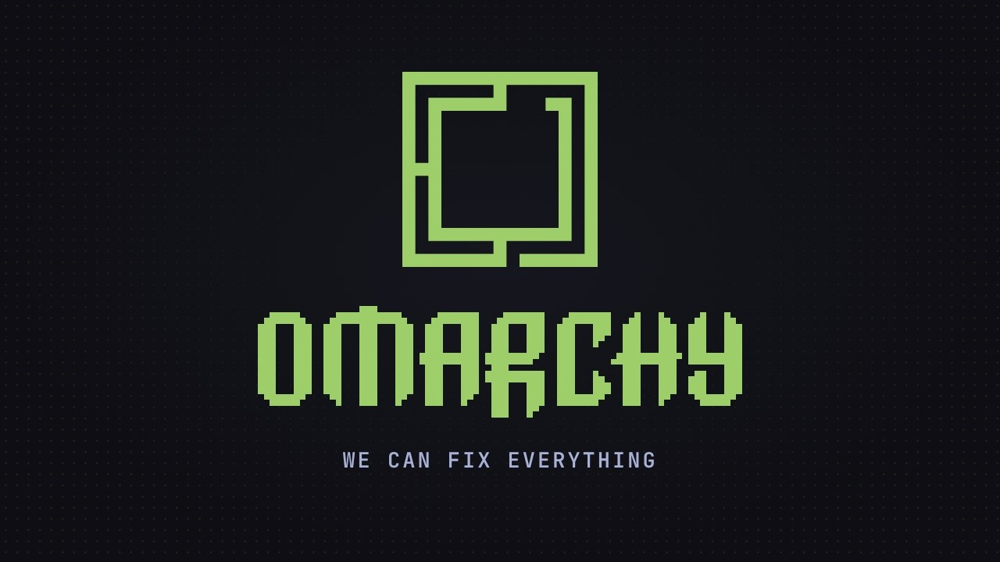
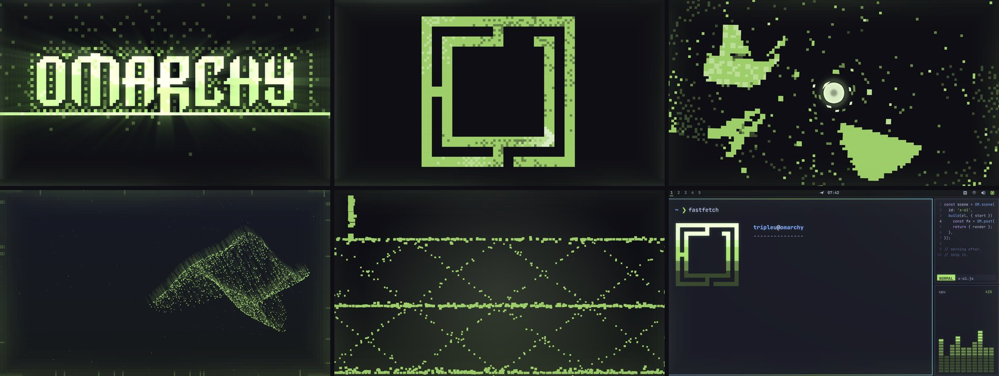

<p align="center">
  
</p>

<h1 align="center">We Can Fix Everything</h1>

<p align="center">
  A music video for the Omarchy anthem, made entirely in code.<br>
  <a href="https://youtu.be/R91DhtkbYLs"><b>Watch it on YouTube</b></a> · 4K · 60 fps · 5:06 ·
  <a href="https://github.com/TripleU613/OmarchThemeVideo">github.com/TripleU613/OmarchThemeVideo</a>
</p>

---

*We Can Fix Everything (The Ultimate Machine)* by Kevin Koontz / REARRANGED, as a
five-minute film in the Tokyo Night look of [omarchy.org](https://omarchy.org).

There's no video editor, no stock footage and no generated imagery. It's 66 scenes of
JavaScript drawing on canvas, rendered to video with
[HyperFrames](https://hyperframes.heygen.com):

- **One idea per sung line.** Every line gets its own visual metaphor, and the words
  are the material the idea acts on, never a caption.
- **On the vocal.** Every word lands on its sung onset, from forced alignment against
  the isolated vocal.
- **On the drums.** A shared edit camera punches, jolts and rolls on the drums measured
  on the song itself, and builds through the fills into each drop.
- **Invisible cuts.** Scenes hand off on agreed frames, so the film plays as one take.

<p align="center"></p>

## How it's made

```
song ──► analysis/         word timing, beats, drums          lines.json, drums.json
lyrics ► lyrics-from-lrc   your words on that timing           lyrics.txt → lyrics.js
ideas ─► storyboard/       one idea per line                   IDEAS.md, scenes.json
       ► assemble          scene windows and pages             index.html, dev.html
       ► assets/scenes/    66 scenes, one file each
       ► render            HyperFrames, 4K at 60 fps           renders/*.mp4
```

1. **Analysis** (`analysis/`, Python). Demucs isolates the vocal and a wav2vec2 forced
   aligner places every word on it (`align.py`, `refine.py`, `finalize.py` →
   `lines.json`). `refine_events.py` measures every kick, snare, fill and beat on the
   song at its attack (`drums.json`), and `features.py` precomputes the spectrum the
   scenes react to.
2. **Lyrics.** `npm run lyrics:from <file.lrc|.srt|.ass>` lays a word-by-word lyric file
   onto the aligned timing, and `npm run lyrics:build` turns it into `lyrics.js`. Scenes
   only ever reach the words through `OM.sung(id)`.
3. **Ideas.** `storyboard/IDEAS.md` holds the idea for every line, and
   `storyboard/scenes.json` the scene list. The three choruses escalate: one person and
   one machine, then a crowd and a city, then the world.
4. **Assemble.** `npm run assemble` places every scene on the beat before its first word
   and writes `index.html` for rendering, `dev.html` for the live player, and
   `STORYBOARD.md`.
5. **Scenes.** Each scene is a pure function of song time:
   `OM.scene({ id, build(el) { return { render(t, T) {} } } })`. It runs its own camera
   and GLSL shader (`assets/lib/post.js`). Over all of them run two shared layers: the
   edit camera (end of `assets/lib/kit.js`) and a border of frame effects
   (`assets/lib/frames.js`).
6. **Check and render.** `npm run verify` checks the repo, and CI runs it with the
   assemble and lint checks. `npm run render:4k` renders the final cut (about 18 minutes
   on one L40 GPU).

## Repository

```
analysis/              song → timing data (Python)
music-video/           the HyperFrames composition
  assets/scenes/       the 66 scenes, one file per line
  assets/lib/          the engine: stage, kit, edit camera, post, frames, timing
  assets/vendor/       three.js, GSAP
  storyboard/          ideas, scene list, effects plan, agent briefs
  scripts/             assemble, verify, timing, lyrics, render, checks
docs/                  images for this page
LICENSES/              third-party license texts
```

## Run it

```bash
git clone https://github.com/TripleU613/OmarchThemeVideo
cd OmarchThemeVideo/music-video
npm run serve            # live player at http://localhost:3123/dev.html
npm run assemble         # rebuild the pages after changing the storyboard
npm run verify           # repo checks (CI runs these too)
npm run render:4k        # final render, 3840x2160 at 60 fps
```

Player keys: space plays, arrows move 2 s, Shift+arrows jump scenes, `,` and `.` step a
frame, L loops the scene, M mutes. The time lives in the URL (`#t=81.25`).

## Make your own

1. Put your song at `music-video/assets/audio/song.wav` and run the analysis in
   `analysis/` to get `lines.json` and `drums.json`.
2. `npm run lyrics:from <your.lrc>`, then `npm run lyrics:build` and `npm run timing`.
3. Write your ideas, list your scenes in `storyboard/scenes.json`, `npm run assemble`.
4. Build the scenes by hand or with agents (`storyboard/AGENT-BRIEF.md`), watching them in
   `npm run serve`. `AGENTS.md` has the rules every scene follows.
5. `npm run verify`, then render.

## Credits

Made by [TripleU613](https://github.com/TripleU613), with coding agents working from one
shared brief. Song: *We Can Fix Everything (The Ultimate Machine)* by Kevin Koontz /
REARRANGED, used with permission. Omarchy by DHH. Built with HyperFrames, three.js and
GSAP; type is JetBrains Mono.

## License

The code is [MIT](LICENSE). The song, its words and the Omarchy marks belong to their
owners and aren't covered by it; see [THIRD-PARTY-NOTICES.md](THIRD-PARTY-NOTICES.md).
